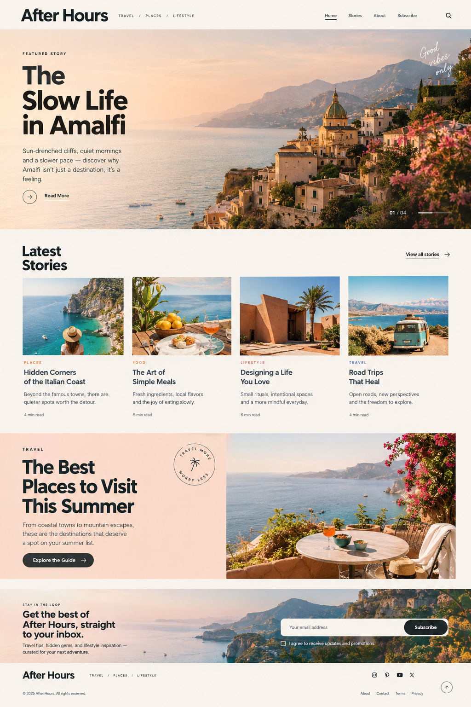

# After Hours — Editorial Magazine Website

A responsive single-page travel, places, and lifestyle magazine built with plain HTML, CSS, and JavaScript.

## Run it
1. Extract the ZIP file.
2. Open `index.html` in a modern browser.

No build step or package installation is required. The page uses Google Fonts and remote Unsplash image URLs, so an internet connection is needed for those assets.

## Included interactions
- Responsive navigation and mobile menu
- Search overlay that filters the included stories
- Clickable story cards with article-detail modals
- Scroll-triggered reveal animations and active navigation state
- Newsletter form validation and success feedback
- Back-to-top button
- Reduced-motion accessibility support

## Website Preview

## Note
The newsletter form is front-end only: it validates the address and displays a success message, but it does not save subscribers or send email. Connect it to your backend or an email marketing service for real subscriptions.

